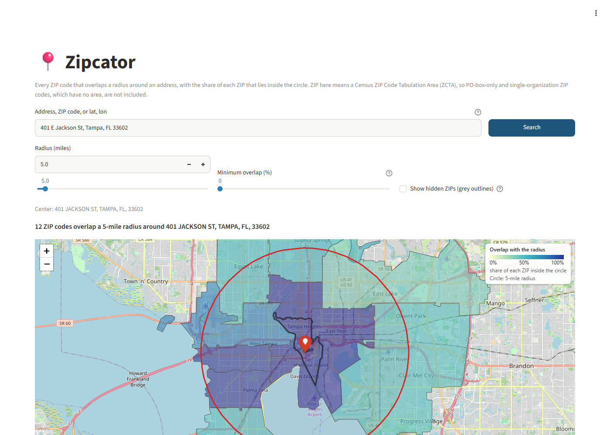

# Zipcator

Type a US address and a radius in miles; get **every ZIP code whose area overlaps the circle**,
with the **percentage of each ZIP that lies inside it**, on a map and in a table, ready to export
as a CSV or a copy-paste ZIP list. Built for local-business marketing: direct mail, Meta / Google
Ads ZIP targeting, flyering.



> **ZIP here means a Census ZIP Code Tabulation Area (ZCTA), so PO-box-only and
> single-organization ZIP codes, which have no area, are not included.**

## Why overlap, not "centroid in circle"

Many tools list the ZIPs whose *center point* is inside the radius. In rural areas that fails
badly: the ZIP your address is in can be so large that its center is 20 miles away. Zipcator
intersects the real ZIP polygons with a true geodesic circle, so the ZIP containing the address is
never missed and large ZIPs at the edge of the circle are found. Near Okeechobee, FL, a 10-mile
search finds two ZIPs (34972, the one the address is in: 17 % inside the circle; and 34974: 28 %).
A search that tests one center point per ZIP never finds 34972 at 10 miles or below: using the
ZIP's representative point (a point guaranteed to be inside it) it finds nothing at all, and using
the true polygon centroid it finds only 34974, and only from 10 miles. A *minimum overlap* filter
then trims ZIPs that only barely touch the circle. (Measured on the real data; see
[docs/QA_REPORT.md](docs/QA_REPORT.md).)

## Quick start

You need [`git`](https://git-scm.com/), [`uv`](https://docs.astral.sh/uv/) (it installs the right
Python for you) and an internet connection for the one-time setup. Works on Windows, macOS and
Linux. Install `uv` once, then **open a new terminal** so it is on your `PATH`:

```powershell
# Windows PowerShell
powershell -c "irm https://astral.sh/uv/install.ps1 | iex"
```

```bash
# macOS / Linux
curl -LsSf https://astral.sh/uv/install.sh | sh
```

Then, in any shell (these commands are the same everywhere):

```
git clone https://github.com/jpmacolino/project-zipcator.git
cd project-zipcator

uv sync                                     # install dependencies
uv run python scripts/build_data.py         # one-time data build (~1 min, ~75 MB download)
uv run streamlit run app/streamlit_app.py   # open the app in your browser
```

The data build downloads the public Census and GeoNames files, joins them, and writes
`data/zcta.parquet` (about 40 MB) plus `data/metadata.json`. Nothing under `data/` is committed.
Re-running is safe and reuses the cached downloads; add `--refresh` to download again. If the data
is missing the app tells you exactly this instead of failing.

## Using the app

1. Type an **address** (`401 E Jackson St, Tampa, FL 33602`), a **5-digit ZIP** (`33602`, centered
   on that ZIP's representative point and labelled approximate) or **coordinates**
   (`27.9506, -82.4572`), then press **Search** or Enter. Typing alone never searches.
2. Set the **radius** (0.5 to 100 miles; number box and slider stay in sync) and an optional
   **minimum overlap %**. The ZIP that contains the address is always shown, even below the
   minimum. Radius and minimum can be changed after a search without geocoding again.
3. Read the **summary**, hover the **map** (ZIP, city and overlap % in the tooltip; the darker the
   fill, the more of the ZIP is inside the circle; the home ZIP has a heavy outline) and sort the
   **table**. *Show hidden ZIPs* draws ZIPs below the minimum as grey outlines.
4. **Export**:
   * **Download CSV for Excel**: ZIPs are written as `="02108"` so Excel keeps leading zeros
     (Excel otherwise turns `"02108"` into the number 2108 even from a quoted CSV).
   * **Download CSV (plain, for scripts)**: standard CSV with quoted text ZIPs; read it with
     `pd.read_csv(path, dtype={"ZIP": str})` to keep the zeros.
   * **ZIP list**: comma-separated or one per line, for pasting into ad platforms.

If an address matches several places (`100 Main St, Springfield`) you pick the one you meant.

## Command line

```powershell
uv run zipcator "401 E Jackson St, Tampa, FL 33602" --radius 10 --min-overlap 5 --csv out.csv
uv run zipcator 33602 -r 3                 # a ZIP
uv run zipcator "27.9506, -82.4572" -r 5   # coordinates
uv run zipcator 33602 -r 3 --zips          # just the copy-paste list (summary on stderr)
uv run zipcator -r 5 -- "-14.27,-170.7"    # a negative first number goes after --
```

Exit status: `0` success (including "no ZIP codes"), `1` address not found / non-US location /
geocoder unavailable / write error, `2` invalid arguments, `3` ZIP data missing (build it first),
`130` interrupted. `uv run zipcator --help` lists every option.

## What to know (limitations)

* **ZIP = ZCTA.** ZCTAs are Census polygons built from census blocks (2020 vintage, current until
  the 2030 census). USPS ZIPs are delivery routes, not areas, so PO-box-only and single-organization
  ZIPs have no polygon and are missing.
* **State and county** come from the county that holds most of the ZCTA, so 13 border ZCTAs show a
  state that differs from their postal address (e.g. 82930 Evanston is labelled UT; USPS says WY).
* **Polygons are the 1:500,000 shoreline-clipped boundary file**, simplified (tolerance 0.0005°,
  shared edges simplified once so neighbours never overlap). Measured against the unsimplified
  shapes, overlap % moved by at most 0.20 percentage points (worst case: a 100-mile search around
  Orlando) across the nine verification scenarios in [docs/QA_REPORT.md](docs/QA_REPORT.md).
* **"Area in radius" is polygon area**, not land area: inland water, bays and lagoons inside a ZCTA
  count (open ocean does not, because the polygons are clipped to the shoreline).
* **Population** (optional, see below) is a *rough estimate* that assumes people are spread evenly
  across each ZIP.
* **United States only.** Coordinates and addresses outside the US are refused. The check is a
  coarse bounding box, so a point just across the Canadian or Mexican border is searched and simply
  finds few or no ZIPs. Circles that cross the 180° meridian (far-western Aleutians) or enclose a
  pole are rejected with a message.

## Optional: population

```powershell
# Windows PowerShell (free key: https://api.census.gov/data/key_signup.html)
$env:CENSUS_API_KEY = "your-free-key"
uv run python scripts/build_data.py --with-population
```

```bash
# macOS / Linux
export CENSUS_API_KEY="your-free-key"
uv run python scripts/build_data.py --with-population
```

Adds ACS 5-year population per ZCTA, plus an estimated population inside the radius. The Census API
now requires a key. The build succeeds without it (that is the default). This path has been tested
against recorded responses only, not the live API.

## Data sources, licenses and attribution

| data | source | license |
|---|---|---|
| ZIP polygons | US Census Bureau 2020 ZCTA cartographic boundary file, 1:500k (`cb_2020_us_zcta520_500k`) | public domain |
| State and county per ZIP | Census 2020 ZCTA-to-county relationship file | public domain |
| City names | [GeoNames](https://www.geonames.org) postal codes (US plus PR, VI, GU, AS, MP files) | **[CC BY 4.0](https://creativecommons.org/licenses/by/4.0/)** |
| Population (optional) | Census ACS 5-year, table B01003 | public domain |
| Address lookup | US Census Geocoder (primary) | public domain |
| Address lookup (fallback) and map tiles | [OpenStreetMap](https://www.openstreetmap.org/copyright) contributors | ODbL |

GeoNames attribution is required and appears in the app footer. Zipcator itself is MIT licensed.

## Geocoding and the Nominatim usage note

Addresses go to the **US Census Geocoder** first (no key needed). Only if it finds nothing or fails
does Zipcator ask OpenStreetMap's public **Nominatim** service, within its
[usage policy](https://operations.osmfoundation.org/policies/nominatim/): US results only
(`countrycodes=us`), at most one request per second, results cached, and a descriptive
`User-Agent`. That public service is for light, occasional use; do not point a batch job or a busy
hosted copy at it. Please set `ZIPCATOR_USER_AGENT` to something that identifies you (with a contact)
if you run this beyond personal use, or disable the fallback with `ZIPCATOR_DISABLE_NOMINATIM=1`.

## Configuration

Environment variables only; there is no config file and nothing secret in the repository.

| variable | meaning |
|---|---|
| `ZIPCATOR_DATA_DIR` | where `zcta.parquet`, `metadata.json` and the download cache live (default `<repo>/data`) |
| `ZIPCATOR_USER_AGENT` | `User-Agent` for geocoder requests (default `zipcator/<version> (+<repo url>)`) |
| `ZIPCATOR_DISABLE_NOMINATIM` | `1` turns the Nominatim fallback off |
| `CENSUS_API_KEY` | Census API key, only for `--with-population` |

After rebuilding the data, restart a running app (it caches the loaded data).

## Development

```powershell
uv sync                                   # setup
uv run python scripts/check.py            # all gates: ruff, format, mypy, tests + coverage, file size
uv run pytest                             # unit, property and UI (AppTest) tests: fast, offline
uv run pytest -m data                     # golden scenarios and smoke tests on the real data
uv run pytest -m slow                     # performance budgets
uv run pytest -m network                  # a few polite live calls to Census and Nominatim
uv sync --group visual; uv run playwright install chromium
uv run pytest -m visual                   # real-browser tests + screenshots in qa/screenshots/
uv run python scripts/verify_golden.py    # the independent-reference verification table
```

* `src/zipcator/` holds all logic (`geo`, `search`, `geocode`, `data_build`, `data`, `export`,
  `mapview`, `ui`, `cli`); `app/streamlit_app.py` is layout only.
* Correctness is checked against an independent implementation (unsimplified raw polygons, a
  different circle and projection) and with mutation testing of the key behaviours; see
  [docs/QA_REPORT.md](docs/QA_REPORT.md). Design decisions and their reasons are in
  [docs/DECISIONS.md](docs/DECISIONS.md); the specification is [docs/SPEC.md](docs/SPEC.md).
* CI (GitHub Actions) runs the gates on Ubuntu and Windows with Python 3.11 and 3.12.

## License

[MIT](LICENSE). Data licenses are listed above.
